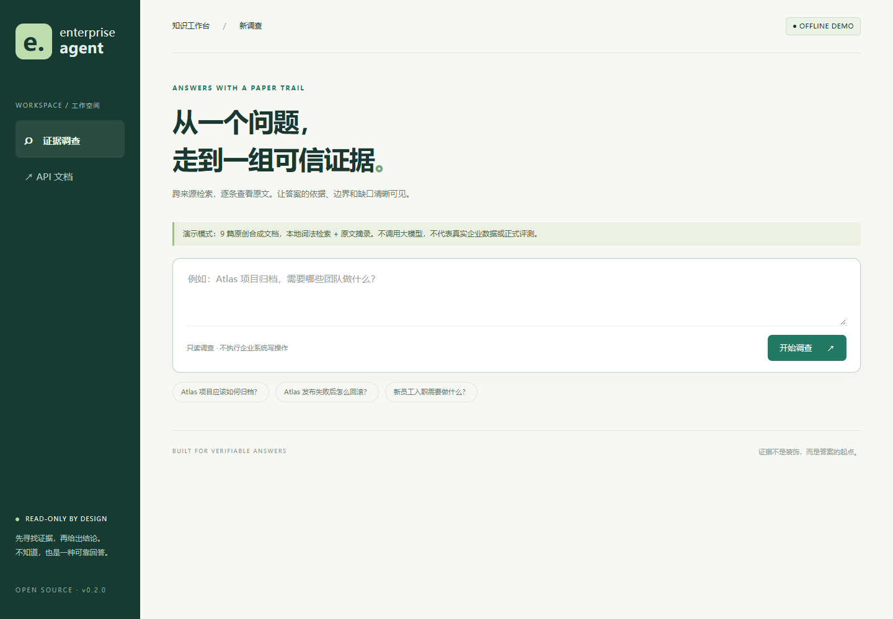

# Enterprise Agent

**Ask enterprise questions. Inspect the evidence. See what is still unknown.**

A read-only, evidence-first RAG investigation workspace. LangGraph orchestrates
policy-controlled searches; hybrid retrieval finds candidate evidence; an
evidence judge separates supported facts, missing information and conflicts.
The browser workspace shows the answer next to its source excerpts.

[中文说明](README.zh-CN.md) · [Deployment](docs/DEPLOYMENT.md) · [Evaluation](docs/EVALUATION.md) · [Contributing](CONTRIBUTING.md) · [Roadmap](ROADMAP.md)

[What was actually verified](docs/VERIFICATION.md) — including the local Docker proxy limitation.

Status: **0.5.0 alpha — a locally testable open-source release candidate**, not
an audited enterprise SaaS. No production accuracy, customer adoption or Star
counts are claimed. This project is distinct from the upstream
[EnterpriseRAG-Bench](https://github.com/onyx-dot-app/EnterpriseRAG-Bench); see [NOTICE](NOTICE).



## Try it without a GPU or API key

From this repository's root (`enterprise_agent` in the original workspace), with
Python 3.12+ and [uv](https://docs.astral.sh/uv/getting-started/installation/):

```bash
uv sync --locked --no-dev
uv run --no-sync enterprise-agent-serve --mode demo --port 8010
```

Open **http://127.0.0.1:8010**. Try “Atlas 项目应该如何归档？” or
“How do we roll back an Atlas release?”. No Node build is required.

The demo performs **real local BM25 retrieval and displays verbatim excerpts**
from nine original synthetic documents. It makes **no model/network calls**.
It is not the full LangGraph pipeline and its scores are not production quality claims.
Installation can require internet access; the running demo does not.

Alternatively, with Docker:

```bash
docker compose -f compose.demo.yaml up --build
```

The demo binds only to `127.0.0.1:8010`. Stop it with
`docker compose -f compose.demo.yaml down`.

## What you get

**Bring your own documents:** open **我的知识库 / My knowledge**, create a library,
and upload TXT, Markdown, text-based PDF or DOCX. Wait for Ready, select that
library and ask. Includes durable background parsing, retries, replace/delete,
source-location previews, private ownership and verified online backups.
Personal retrieval defaults to local BM25. Start with `--enable-setup` for the
loopback-only model wizard, then opt into the shared LangGraph planner, policy,
evidence judge, follow-up searches and citation answer path. Optional exact-vector
indexing, RRF and TEI reranking require explicit provider configuration and consent;
uploads never automatically call a model. This uses a separate owned SQLite
library, not the enterprise OpenSearch index. Model auditing is not human assurance.
For stable authenticated identity without OpenSearch use `--mode workspace`.
Index builds now preview pending chunks/characters/batches, reuse unchanged-file
vectors, persist successful batches for explicit retries, and reserve bounded
per-owner/global vector capacity. Upload concurrency and body-read deadlines are
bounded; slow embedding calls no longer block the file parser. These are small
workspace controls, not a distributed service or an exactly-once billing promise.
See [personal knowledge setup and limits](docs/KNOWLEDGE.md).

| Capability | Available in this release |
|---|---|
| Inspectable workspace | Source excerpts, citation IDs, fact assessments, tool summaries, JSON export |
| Live RAG Agent | Scope check → planner → policy → retrieval → evidence judge → answer / re-search |
| Hybrid retrieval | BM25 + vectors → RRF → optional/required cross-encoder reranking |
| Access boundary | Server-owned bearer identities, tenant/source policies, ACL filtering and result rechecks |
| Safe index replacement | Tenant/source-scoped chunk IDs; validated full snapshots; atomic alias switch; old generations retained |
| Read-only data import | UTF-8 Markdown/text folder; GitHub issue title/body export with explicit ACLs |
| Reproducible evaluation | Document Hit@K, Recall@K, MRR@K, binary nDCG@K, p50/p95, per-case JSON and dataset fingerprint |
| Contributor workflow | Offline tests, opt-in OpenSearch integration test, Linux/Windows CI, package and browser smoke checks |

Nine source categories are supported by the data contract: Confluence,
Fireflies, GitHub, Gmail, Google Drive, HubSpot, Jira, Linear and Slack.
**This does not mean nine native live connectors exist.**

## Connect real data and models

Live mode uses your OpenAI-compatible LLM/embedding service, OpenSearch and
TEI-compatible reranker. Model choice is configurable; BGE-M3 and
`BAAI/bge-reranker-v2-m3` are example configurations, not a benchmark win claim.

1. Follow [deployment](docs/DEPLOYMENT.md) to configure providers and create a scoped identity.
2. Export authorized documents using [connectors](docs/CONNECTORS.md).
3. Review the full tenant export and publish a [versioned snapshot](docs/INDEX_LIFECYCLE.md).
4. Start `enterprise-agent-serve --mode live --identity-file .local/identities.json --port 8000`.

Live mode **refuses to start without identities**. It never takes tenant IDs or
roles from a question/request body. Existing no-auth deployments must migrate;
the old running service is not automatically reconfigured.

## Verify rather than trust a screenshot

```bash
uv sync --locked
uv run enterprise-agent-doctor --mode demo
uv run pytest -q
uv run enterprise-agent-eval --mode demo --output artifacts/demo-eval.json
uv run enterprise-agent-eval-knowledge --output artifacts/personal-eval.json
uv build
```

Reports refuse to overwrite existing files. For the real BM25/vector/RRF/reranker
comparison, label your own corpus and use [the evaluation guide](docs/EVALUATION.md).
The tiny demo is a smoke check, **not a quality leaderboard**.

## Architecture and scope

```text
Browser / API → trusted identity → scope gate → LangGraph planner
                                              ↓
                  answer ← evidence judge ← policy-controlled search
                               ↓                 BM25 + vector → RRF → rerank
                       re-plan when needed

Read-only connectors → ACL-tagged chunks → validated new index → read alias
```

The UI displays observable tool results, not hidden chain-of-thought. Documents
remain untrusted input. No system can promise zero hallucinations or universal
prompt-injection resistance. This release does not implement SSO, native SaaS
ACL synchronization, multi-turn memory, durable run checkpoints, token streaming,
distributed quotas or a managed cloud service. Read [security](SECURITY.md)
before exposing it beyond localhost.

## Contribute

Useful first contributions: independently labelled evaluation cases, a failing
retrieval/ACL test, multilingual accessibility improvements, or a narrowly
scoped read-only connector. See [CONTRIBUTING.md](CONTRIBUTING.md).

Code: MIT. Model weights, external data and libraries retain their own terms.
