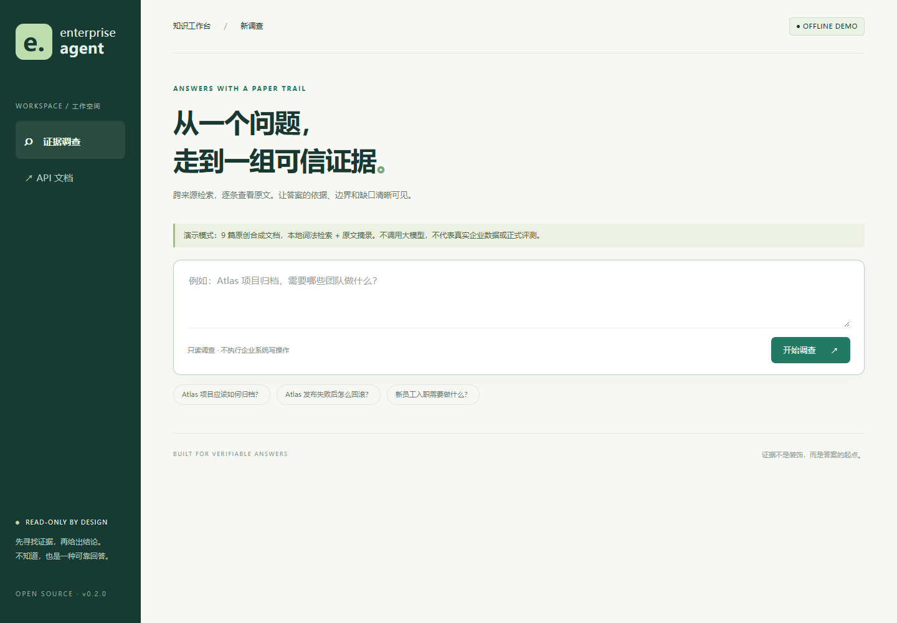

# Enterprise Agent · 企业证据调查工作台

把“答案是怎么来的”展示清楚：只读调查企业知识，显示原文证据、引用编号、
事实支持情况和仍然缺失的信息。基于 LangGraph、FastAPI、OpenSearch。

[English](README.md) · [部署](docs/DEPLOYMENT.md) · [接入数据](docs/CONNECTORS.md) · [评测](docs/EVALUATION.md) · [路线图](ROADMAP.md)

[本次验证记录](docs/VERIFICATION.md)：含已通过的测试与本机 Docker 代理阻塞说明。

当前是 **0.5.0 alpha 开源候选版本**，不是已通过安全审计的企业 SaaS。
100 万 Star 是愿景，不是交付指标；不会编造客户案例、召回率或社区规模。



## 先运行，不用配置模型

在项目根目录执行（Python 3.12+，已安装 uv）：

```powershell
uv sync --locked --no-dev
uv run --no-sync enterprise-agent-serve --mode demo --port 8010
```

浏览器打开 **http://127.0.0.1:8010**。也可以执行：

```powershell
docker compose -f compose.demo.yaml up --build
```

演示包含 9 篇原创中英文合成文档，执行本地 BM25 检索并摘录原文。
它不调用大模型、不访问真实企业数据，不代表完整 Agent 的效果。
安装依赖需要网络；运行离线演示不需要。页面可以查看证据和导出本次调查。

## 上传自己的资料

点击页面的 **我的知识库 → 创建知识库 → 上传文件**，等状态为“可用”后，
选择该知识库提问。支持 **TXT、Markdown、文本型 PDF、DOCX**；可查看原文位置、
替换、删除、失败重试，重启服务后资料仍保留。不支持扫描件 OCR 和 Excel。

个人资料默认执行本地 BM25 检索并摘录原文。使用 `--enable-setup` 开启本机
模型向导，保存并测试配置后，可明确选择完整 Agent（规划、检索、审核、补充检索、回答）。
向量索引需另行确认构建，之后可用 BM25 + 向量 + RRF + TEI 重排；不会随上传自动计费。
个人知识库与企业 OpenSearch 索引独立，复用同一套 Agent 图；模型审核仍需核对原文。
本机 demo 的上传身份依赖浏览器 Cookie；重要资料用带令牌的 `--mode workspace`。
构建前会预估需要发送的切块、字符和批次；同模型下复用未变动文件的向量，失败后
可复用已保存批次。新增上传并发/超时、每用户与全局向量额度、磁盘余量保护，
并将文件解析与向量调用分开执行。仍需手动确认外部调用，不承诺供应商“恰好计费一次”。
详见 [知识库使用、备份与安全边界](docs/KNOWLEDGE.md)。

Windows 可用 `.\scripts\start-workspace.ps1 -EnableSetup` 后台启动，关闭终端不影响服务。
这不是开机自启；关机后需要再次启动。

## 企业检索的两种模式不要混淆

| | demo | live |
|---|---|---|
| 输入数据 | 内置合成样本 | 你授权导入的企业资料 |
| 检索 | 本地 BM25 | OpenSearch BM25 + 向量 + RRF + 精排 |
| 回答 | 原文摘录，无模型审核 | 规划、审核、引用回答、必要时继续检索 |
| 成本 | 无模型费用 | 取决于服务商、模型和调用量 |
| 身份 | 固定样本访问 | 服务端配置访问令牌 → 租户/用户/数据源权限 |

真实模式先看 [部署指南](docs/DEPLOYMENT.md)。不要把演示里的固定身份用于真实资料。
9 类来源是数据模型支持的分类，不等于实现了 9 个 SaaS 实时连接器。
本版本实际新增两个只读入口：本地 Markdown/TXT 和 GitHub Issue 标题/正文。

## 这次产品化解决了什么

- 不用 GPU、OpenSearch 或模型 Key，也能体验证据工作台。
- 原文证据与 E1/E2 引用保持一致，真实模式返回前重新检查索引 ACL。
- 切块 ID 加入租户和来源命名空间；旧 JSONL 导入时也会重新计算 ID。
- 完整快照导入新索引，成功后切换别名。失败不切换，旧版本不自动删除。
- Hit、Recall、MRR、nDCG、延迟和逐样本结果可复现；演示与正式实验分开。
- 补齐贡献、安全、许可、变更日志、CI、安装和发布流程。

## 自己验证

```powershell
uv sync --locked
uv run pytest -q
uv run enterprise-agent-doctor --mode demo
uv run enterprise-agent-eval --mode demo --output artifacts/demo-eval.json
uv run enterprise-agent-eval-knowledge --output artifacts/personal-eval.json
uv build
```

真实评测需要固定数据版本和人工标注。演示集很小，不能拿它的分数当作
“企业场景召回率”。检索质量与最终回答忠实度也不是同一个指标。

仍未实现：SSO、原生 SaaS 权限同步、跨轮记忆、持久检查点、Token 流式输出、
分布式限流、托管云服务。现有资料来自 EnterpriseRAG-Bench 工作区，
本 Agent 不冒充上游官方产品；详见 [NOTICE](NOTICE)。
