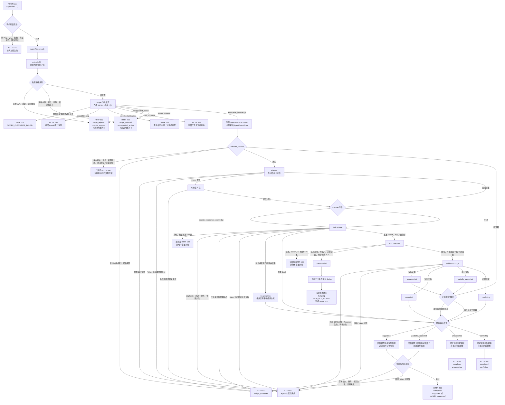
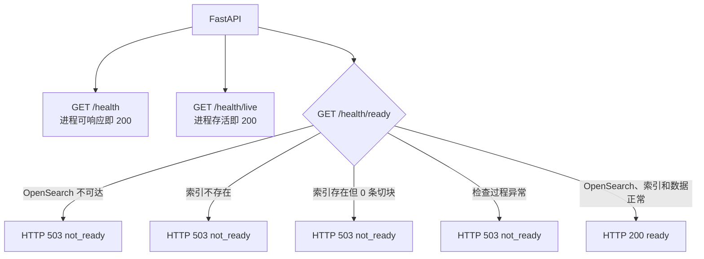

# Enterprise Agent 架构与运行分支

更新时间：2026-08-18

本文档描述当前源码中的真实架构，包含模块分层、`POST /ask` 的主要运行分支、健康检查分支和当前尚未完成的生产能力。

## 1. 项目整体架构

```mermaid
flowchart TB
    ROOT["Enterprise Agent 项目"]

    ROOT --> ENTRY["交付与运行入口"]
    ENTRY --> API["FastAPI<br/>enterprise_agent.api:app"]
    ENTRY --> CLI["完整 Agent CLI<br/>enterprise-agent-run"]
    ENTRY --> DATA_CLI["数据与检索 CLI<br/>index / ingest / search"]
    ENTRY --> TUTORIAL["tutorial 与 smoke 脚本<br/>仅教学和冒烟测试"]

    ROOT --> CONTROL["Agent 控制与编排层<br/>src/enterprise_agent/agent"]

    CONTROL --> RUNNER["runner.py<br/>一次请求的总入口"]
    CONTROL --> SCOPE["scope_service.py<br/>范围门禁"]
    CONTROL --> STATE["contracts.py + state.py<br/>身份、权限、预算、图状态"]
    CONTROL --> GRAPH["graph.py<br/>LangGraph 状态机"]
    CONTROL --> PLANNER["planner.py<br/>规划下一步动作"]
    CONTROL --> POLICY["policy.py<br/>审批 Planner 动作"]
    CONTROL --> EXECUTOR["tool_executor.py<br/>执行批准动作"]
    CONTROL --> JUDGE["evidence_judge_node.py<br/>审核证据"]
    CONTROL --> ROUTING["evidence_routing.py<br/>回答、重搜、拒答、冲突"]
    CONTROL --> ANSWER["answer_node.py<br/>生成最终回答"]

    ROOT --> RETRIEVAL["在线检索层<br/>src/enterprise_agent/retrieval"]

    RETRIEVAL --> REWRITE["query_rewriter.py<br/>中文问题改写增强"]
    RETRIEVAL --> KEYWORD["keyword_search.py<br/>BM25 关键词检索"]
    RETRIEVAL --> VECTOR["vector_search.py<br/>BGE-M3 向量检索"]
    RETRIEVAL --> HYBRID["hybrid_search.py<br/>RRF 融合排序"]
    RETRIEVAL --> TOOL["enterprise_search.py<br/>统一企业检索工具"]
    HYBRID --> KEYWORD
    HYBRID --> VECTOR

    ROOT --> INGESTION["离线数据处理层<br/>src/enterprise_agent/ingestion"]

    INGESTION --> SOURCES["9 类原始 JSON 数据<br/>Jira、Slack、Confluence、Gmail<br/>Drive、GitHub、Linear、HubSpot、Fireflies"]
    INGESTION --> READER["data_reader.py<br/>统一读取文档"]
    INGESTION --> AUDIT["data_audit.py<br/>数据质量检查"]
    INGESTION --> CHUNKER["chunker.py<br/>结构化切块"]
    INGESTION --> JSONL["artifacts/*.jsonl<br/>切块中间产物"]
    INGESTION --> EMBED["生成 1024 维向量"]
    INGESTION --> BULK["批量写入 OpenSearch"]

    SOURCES --> READER --> AUDIT --> CHUNKER --> JSONL --> EMBED --> BULK

    ROOT --> GENERATION["生成与证据层<br/>src/enterprise_agent/generation"]
    GENERATION --> PROMPT["prompt_builder.py<br/>RAG 提示词"]
    GENERATION --> EJUDGE["evidence_judge.py<br/>结构化证据审核"]
    GENERATION --> RETRY_JUDGE["resilient_judge_client.py<br/>审核输出修复重试"]

    ROOT --> INFRA["基础设施层<br/>src/enterprise_agent/infrastructure"]

    INFRA --> LLM["AutoDL DeepSeek<br/>OpenAI-compatible API"]
    INFRA --> BGE["本地 Ollama BGE-M3<br/>Embedding"]
    INFRA --> OS["OpenSearch 3.7<br/>BM25 + 向量索引"]
    INFRA --> DOCKER["Docker Compose<br/>本地服务运行"]
    INFRA -. "依赖已安装但尚未接线" .-> PG["PostgreSQL Checkpoint"]

    ROOT --> QUALITY["质量保障"]
    QUALITY --> TESTS["tests/<br/>单元、图集成、冒烟、API 测试"]
    QUALITY --> EVAL["evaluation/ + eval/<br/>Hit@K、MRR、混合检索、拒答评测"]
```

## 2. `POST /ask` 完整运行分支

## 3. 健康检查分支

## 4. 关键代码阅读顺序

1. [`src/enterprise_agent/web/api.py`](../src/enterprise_agent/web/api.py)：HTTP 请求与响应。
2. [`src/enterprise_agent/agent/runner.py`](../src/enterprise_agent/agent/runner.py)：Scope Gate 与 LangGraph 总入口。
3. [`src/enterprise_agent/agent/scope_service.py`](../src/enterprise_agent/agent/scope_service.py)：范围门禁。
4. [`src/enterprise_agent/agent/graph.py`](../src/enterprise_agent/agent/graph.py)：节点与条件边。
5. [`src/enterprise_agent/agent/planner.py`](../src/enterprise_agent/agent/planner.py)：规划动作。
6. [`src/enterprise_agent/agent/policy.py`](../src/enterprise_agent/agent/policy.py)：动作审批。
7. [`src/enterprise_agent/agent/tool_executor.py`](../src/enterprise_agent/agent/tool_executor.py)：执行搜索。
8. [`src/enterprise_agent/agent/evidence_judge_node.py`](../src/enterprise_agent/agent/evidence_judge_node.py)：证据审核。
9. [`src/enterprise_agent/agent/evidence_routing.py`](../src/enterprise_agent/agent/evidence_routing.py)：重搜、回答、拒答和冲突路由。
10. [`src/enterprise_agent/agent/answer_node.py`](../src/enterprise_agent/agent/answer_node.py)：最终回答。

## 5. 当前尚未完成的生产能力

- `execute_search -> evidence_judge` 当前是无条件边，工具失败后仍会进入 Judge。
- PostgreSQL checkpoint 依赖已安装但尚未接入 `graph.compile()`；进程退出后
  不能恢复图的节点执行进度。
- API 仍使用固定的本地演示身份，没有接入 OIDC/JWT。
- 检索和摄取已实现 tenant + user/role/group ACL 的查询前过滤与返回后复验；
  生产环境仍需由真实源系统提供可信 ACL 导出、身份映射和策略版本。
- Agent 图当前只有只读搜索工具，没有企业写工具。
- `awaiting_approval`、`cancelled` 状态已定义，但当前图没有对应执行节点。
- 证据审核最多处理 10 个累计切块；可选 reranker 位于检索内部，尚无独立的
  LangGraph rerank/裁剪节点。
- Scope Gate 在 LangGraph 外，由 Runner 和 CLI 分别调用，存在少量编排重复。
